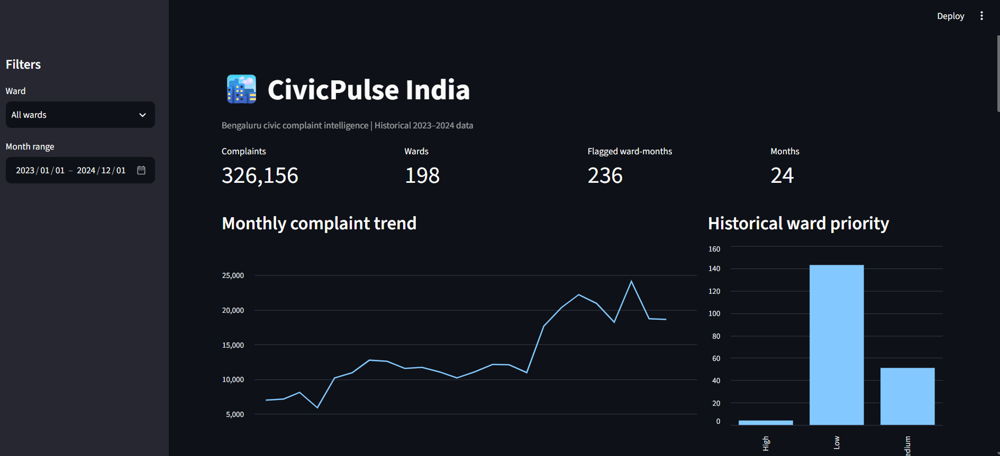
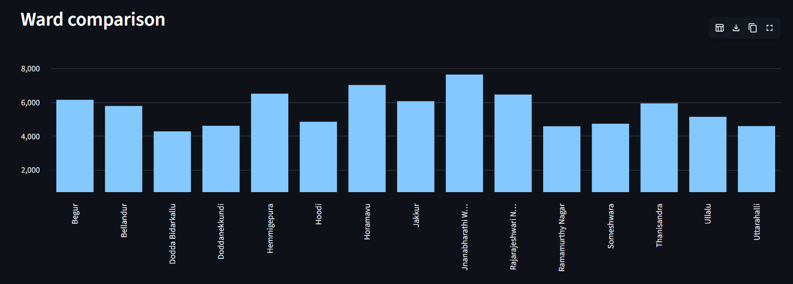

<div align="center">

# 🏙️ CivicPulse India

### Civic Complaint Intelligence · Anomaly Detection · Ward Prioritization

**Bengaluru, India | BBMP civic complaint analysis (2023–2024)**

**Python · Pandas · Scikit-learn · Streamlit · Plotly**

*Turning civic complaint records into actionable urban intelligence.*

</div>

---

## 📌 Project Overview

**CivicPulse India** is a machine learning and analytics project that explores historical civic complaints across Bengaluru's BBMP wards. It combines exploratory analysis, ward segmentation, retrospective anomaly detection, priority scoring, and complaint forecasting in an interactive Streamlit dashboard.

The project analyzes **326,156 complaint records** across **198 wards** over **24 months** (2023–2024). The findings are historical and exploratory, not live government monitoring or verified service-quality measurements.

## 📸 Dashboard Screenshots

### 1. Citywide Dashboard Overview

An overview of complaint volumes, ward coverage, flagged ward-months, trends, and historical priority levels.



### 2. Ward Comparison Dashboard

Compare complaint volumes across Bengaluru wards to identify differences in reported civic issues.



> **Image paths:** Both screenshots are stored in the repository root alongside this `README.md`.

## ✨ Key Features

- **Civic complaint analytics:** Explore complaint volume, categories, and monthly trends.
- **Ward segmentation:** Group wards with similar complaint-category profiles using **K-Means clustering**.
- **Historical anomaly detection:** Flag unusual ward-month complaint patterns using **Isolation Forest** and ward-level **Z-scores**.
- **Priority scoring:** Combine normalized complaint volume (70%) and spike count (30%) to create a historical, heuristic ward priority score.
- **Explainable alerts:** Identify complaint subcategories showing notable month-over-month increases.
- **Complaint forecasting:** Estimate monthly ward complaint volumes with **Random Forest regression**.
- **Rule-based recommendations:** Suggest areas for further review based on reported complaint types.
- **Interactive dashboard:** Inspect and compare historical complaint patterns using Streamlit.

## 🧠 Machine Learning Approach

| Component | Technique | Purpose |
|---|---|---|
| Ward clustering | K-Means | Segment wards by complaint-category mix |
| Anomaly detection | Isolation Forest + Z-scores | Highlight unusual historical complaint activity |
| Priority assessment | Weighted heuristic | Rank historical complaint burden and spikes |
| Forecasting | Random Forest Regressor | Predict monthly ward-level complaint counts |
| Issue recommendations | Rule-based logic | Suggest investigative follow-up actions |

### 📊 Forecasting Results

The documented Random Forest evaluation used **July–December 2024** as a chronological holdout period.

| Metric | Reported result |
|---|---:|
| Mean Absolute Error (MAE) | **22.10 complaints** |
| Root Mean Squared Error (RMSE) | **36.99 complaints** |
| R² score | **0.845** |

These figures are from the documented project evaluation. The uploaded notebook should be run to confirm its own results; a reconstructed notebook may not reproduce the exact metrics.

## 🔎 Example Historical Insight

In **November 2024**, **Maruthi Seva Nagar** recorded **555 complaints**, including **485 reports** in the *UnAuthorised Constructions* category. This month was flagged by the retrospective anomaly analysis. A reasonable follow-up would be to review the reports and verify construction permissions; complaint records alone do not establish a violation.

## 🗂️ Repository Structure

```text
CivicPulse-India/
├── .gitignore
├── CivicPulse.ipynb
├── CivicPulse_India_All_Datasets.zip
├── README.md
├── README.txt
├── app.py
├── civicpulse_dashboard.csv
├── dashboard-overview.png
├── requirements.txt
├── run_app.bat
└── ward-comparison.png
```

## 📂 Data

The repository includes `CivicPulse_India_All_Datasets.zip` and `civicpulse_dashboard.csv`. The original analysis uses BBMP complaint records, Bengaluru rainfall data, and 2011 ward population information. Check the archive contents and original source permissions before redistributing the underlying datasets.

## 🚀 Run the Streamlit Dashboard

1. Clone the repository:

   ```bash
   git clone https://github.com/devilapurv/CivicPulse-India.git
   cd CivicPulse-India
   ```

2. Install the required libraries:

   ```bash
   python -m pip install -r requirements.txt
   ```

3. Launch the dashboard:

   ```bash
   python -m streamlit run app.py
   ```

The dashboard reads `civicpulse_dashboard.csv` from the repository root. On Windows, you can also try `run_app.bat`.

### 📓 Explore the Notebook

Open **`CivicPulse.ipynb`** in Jupyter Notebook or Google Colab to inspect the data analysis and machine learning workflow. If the notebook requires original source CSVs, extract the dataset archive and provide the files as prompted. Notebook outputs and metrics may vary with preprocessing choices and model settings.

## ⚠️ Limitations

- Data represents **historical 2023–2024 records**, not a live civic reporting feed.
- Anomaly flags and priority scores are **retrospective analytical indicators**, not official BBMP decisions.
- Missing ward-month records may indicate unavailable reporting; treating them as zero is a modeling assumption.
- Population counts from **2011** may not align with later ward boundaries.
- Correlations, anomalies, and complaint counts do not independently establish underlying causes or service outcomes.
- The reported forecasting metrics reflect one historical holdout period, not guaranteed future accuracy.

## 🔮 Future Improvements

- Incorporate permissioned, more recent civic complaint data.
- Add geographic ward boundaries and interactive maps.
- Evaluate forecasts with rolling-origin backtesting.
- Improve anomaly explanations and account for reporting biases.

---

<div align="center">

**Developed by [Apurv Singh](https://github.com/devilapurv)**

*CivicPulse India — Data-driven insights for smarter civic analysis.*

</div>
